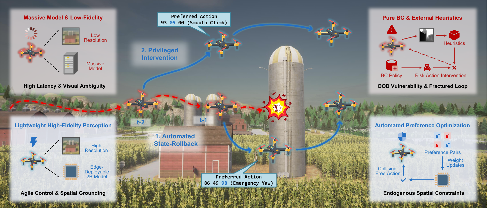

# AeroDPO: Unleashing Lightweight UAV Navigation with High-Fidelity Perception and Automated Preference Optimization

<p align="center">
  <!-- TODO: add teaser figure, e.g.  -->
</p>

AeroDPO is a zero-cost automated preference-optimization pipeline that turns a lightweight 2B vision-language-action (VLA) model into a robust aerial navigator — matching 7B baselines while drastically cutting collisions.

## 📖 Abstract

Vision-Language Navigation for Unmanned Aerial Vehicles (UAV-VLN) requires rapid and reactive control in complex 3D environments. Recent minimalist end-to-end paradigms show great promise but typically rely on massive language models containing billions of parameters, incurring prohibitive latency for real-world edge deployment. In this paper, we challenge this parameter-heavy reliance. Comprehensive cross-scale evaluations reveal the critical insight that perception quality fundamentally outweighs language reasoning capacity. We demonstrate that a lightweight 2B model equipped with high-fidelity visual inputs completely matches the overall success rates of massive 7B baselines. However, this minimalist policy exposes a fundamental robustness flaw inherent to pure Behavior Cloning (BC). Lacking explicit negative feedback, the agent fails to internalize robust spatial constraints and exhibits alarming collision rates in out-of-distribution (OOD) scenarios. To overcome this vulnerability without relying on unscalable human annotations, we propose AeroDPO, a zero-cost automated Direct Preference Optimization pipeline driven by deterministic physical simulation state rollback. Upon detecting collisions, the system autonomously rewinds the environment to extract causal reasoning errors as rejected actions, applies decoupled privileged interventions to synthesize collision-avoidance preferred maneuvers, and leverages an offline vision language inspector to filter visual ambiguities. By equipping our 2B model with this automated data flywheel, AeroDPO boosts success rates to 49.16% on unmapped scenarios while drastically suppressing collision rates, establishing a new SOTA for autonomous aerial agents.

## 🚀 News & Updates

  - **[2026-08]** 🔥 **Initial release:** final AeroDPO model weights + closed-loop evaluation code.
  - **[2026-08]** 📄 **Paper available:** *AeroDPO: Unleashing Lightweight UAV Navigation with High-Fidelity Perception and Automated Preference Optimization* (arXiv:2608.07557).

## 🛠️ Installation

**1. Clone the repository:**

```bash
git clone https://github.com/XuPeng23/AeroDPO.git
cd AeroDPO
```

**2. Create a Conda environment and activate it:**

```bash
conda create -n aerodpo python=3.10 -y
conda activate aerodpo
```

**3. Install PyTorch and core dependencies:**

> AeroDPO is built on **Qwen3-VL**, so it requires newer versions of `torch` and `transformers` than AeroVLA. The following commands target CUDA 12.1 — adjust to match your local CUDA version.

```bash
pip install torch==2.5.1 torchvision==0.20.1 torchaudio==2.5.1 --index-url https://download.pytorch.org/whl/cu121
pip install transformers==5.5.4
pip install numpy==2.2.6
```

**4. Install Flash Attention** (required, since the model loads with `flash_attention_2`):

```bash
# Prebuilt wheel (fastest; pick the one matching your torch/CUDA/Python), or build from source:
pip install flash-attn==2.8.3 --no-build-isolation
```

**5. Install the remaining dependencies:**

```bash
pip install accelerate==1.13.0
pip install peft==0.11.1
pip install qwen-vl-utils
pip install tensorboard matplotlib opencv-python scipy numba attrs yacs
```

**6. Install the AirSim simulation client:**

> **⚠️ Important:** a known `msgpack` version conflict breaks the AirSim RPC channel (symptom: `simGetImages` takes >4s per step, or crashes outright). Pin the versions below — this is the same fix described in the AeroVLA [Troubleshooting Guide](https://github.com/XuPeng23/AeroVLA).

```bash
pip uninstall msgpack msgpack-python msgpack-rpc-python -y
pip install tornado==4.5.3
pip install msgpack-rpc-python==0.4.1
pip install airsim==1.8.1 --no-build-isolation
```

**7. (Only for DPO training) Install TRL:**

```bash
pip install trl==1.4.0
```

## 🌍 Data & Simulation Environment

AeroDPO uses the same simulation setup as [AeroVLA](https://github.com/XuPeng23/AeroVLA): the AirSim simulator and the TravelUAV benchmark. Please follow the AeroVLA repository for downloading the dataset (`dataset_raw/`) and the simulation environments (`envs/`). The `data/` directory contains our per-map evaluation splits (seen / unseen object / unseen map), strictly following the original TravelUAV validation splits.

## 📥 Checkpoints

Two checkpoints are required (provided under `model_zoo/` in this repository, or available on **[Hugging Face](https://huggingface.co/XuPeng23/AeroDPO)**):

| Directory | Role |
|-----------|------|
| `model_zoo/AeroVLA-2B-384-Merged/` | Base AeroVLA 2B model |
| `model_zoo/AeroDPO-2B-384-LoRA/` | AeroDPO LoRA adapter (the final policy) |

The wrapper loads the base model and merges the LoRA adapter on the fly, so no manual merging is needed.

## 📁 Project Structure

```text
AeroDPO/
├── airsim_plugin/            # AirSim client/server + scene launch scripts
├── data/
│   ├── meta/                 # map spawn areas + object descriptions
│   └── uav_dataset/          # per-map evaluation splits
├── dataset_raw/              # ← downloaded raw dataset (see AeroVLA)
├── envs/                     # ← downloaded simulation environments
├── eval_results/             # ← generated at evaluation time
├── model_zoo/
│   ├── AeroVLA-2B-384-Merged/
│   └── AeroDPO-2B-384-LoRA/
├── scripts/
│   ├── eval_auto.sh          # closed-loop evaluation
│   └── metric.sh             # metric aggregation
├── src/
│   ├── common/
│   ├── model_wrapper/
│   └── vlnce_src/
└── utils/
```

## 🏃‍♂️ Evaluation

**1. Start the AirSim servers:**

```bash
cd airsim_plugin
bash start_servers.sh
```

**2. Run closed-loop evaluation:**

Edit `TASK_LIST` in `scripts/eval_auto.sh` to select the map(s) to test, then:

```bash
bash scripts/eval_auto.sh
```

- `BASE_MODEL_DIR` / `LORA_DIR` — the two checkpoints (already set to `model_zoo/`).
- `INSTANCE_ID` — which AirSim server to use; the port is `30000 + INSTANCE_ID * 5000` (e.g., `0` → `30000`).
- `TASK_LIST` — entries look like `seen_valset/Carla_Town07` (category/map).

**3. Calculate metrics:**

```bash
bash scripts/metric.sh
```

*Results are written to `eval_results/<MODEL_NAME>/evaluation_detailed.csv` and `evaluation_summary_aggregated.csv`.*

## 📋 TODO List

- [x] Release the final AeroDPO model weights and evaluation code.
- [ ] Release the training code (SFT + automated DPO mining pipeline) and training dataset.

## 📄 License

This project (code and model weights) is licensed under the **Apache License 2.0**. See the [LICENSE](LICENSE) file for more details.

## ✒️ Citation

If you find our work helpful for your research, please consider citing:

```bibtex
@article{xu2026aerodpo,
  title={AeroDPO: Unleashing Lightweight UAV Navigation with High-Fidelity Perception and Automated Preference Optimization},
  author={Xu, Peng and Wang, Chengcheng and Wan, Shaohua},
  journal={arXiv preprint arXiv:2608.07557},
  year={2026}
}
```
